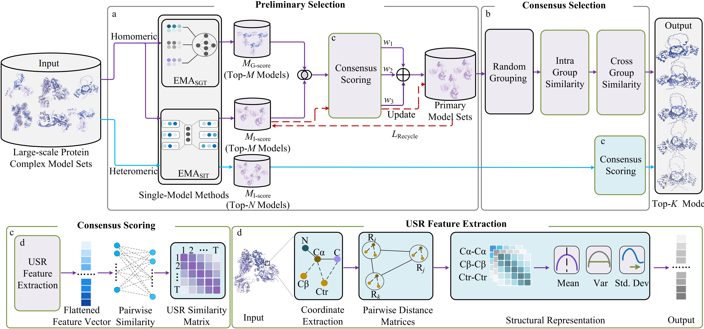

# DeepUMQA-Selection

Consensus-based QA selection driven by two per-model scores: **DeepUMQA-Global (G)**&#8203; and **MViewEMA (MV)**&#8203;. With per-model scores plus **Ultrafast Shape Recognition (USR)**&#8203; descriptors, it outputs the **top-5 models** per target (`Select.mass.txt`).

## 1. Overview

DeepUMQA-Selection is a two-stage consensus framework for selecting high-quality protein complex models from large-scale prediction pools. Two pipelines are provided, selected explicitly per run:

- **homo** (homomeric complexes) — G + MV weighted consensus -> USR iterative refinement -> group review.
- **heter** (heteromeric complexes) — G scores only -> USR similarity ranking.

`homo` / `heter` are the command-line mode values, corresponding to homomeric / heteromeric targets respectively.

One target per run; serial and resumable (existing outputs are skipped). Use **one mode per target**: switching modes requires deleting `output/<target>/` first, because both pipelines share that directory.

⭐ **Overall workflow for the DeepUMQA-Selection** ⭐



### Repository layout

```
DeepUMQA-Selection/
├── run.sh                 entry point (single target)
├── USR_npz.py             local USR feature builder
├── DeepUMQA-Global/       G scores: <target>.csv
├── MViewEMA/              MV scores: <target>.csv
├── homo/                  build_pool.py / refine_pool.py / groups_review.py / homo_select.sh
├── heter/                 usr_select.py / heter_select.sh
├── example/               expected top-5 outputs
├── USR/<target>/          local USR features (generated)
└── output/<target>/       results (generated)
```

## 2. Method Overview

DeepUMQA-Selection is a two-stage framework: a preliminary selection stage screens the candidate pool with per-model scores, and a consensus selection stage re-ranks the retained models through **Ultrafast Shape Recognition (USR)-based structural descriptor comparison**, without explicit structural superposition.

Each candidate model is described by two complementary single-model scores and a structural descriptor:

- **DeepUMQA-Global (G)**<span class="token entity" title="​">&#8203;</span> — a per-model **Score** for interface topology evaluation.
- **MViewEMA (MV)**<span class="token entity" title="​">&#8203;</span> — a per-model **Score** for global topology assessment via multi-view representation learning.
- **USR descriptors** — rotation- and translation-invariant residue-level fingerprints built from distance distributions to three reference points; model pairs are compared directly through these descriptors.

In the manuscript, G and MV are termed **EMA<sub>SIT</sub>** and **EMA<sub>SGT</sub>**, respectively; the **homo** pipeline uses both, whereas **heter** uses G (EMA<sub>SIT</sub>) only.

The **homo** pipeline (homomeric complexes) combines G and MV to build and iteratively refine a weighted candidate pool, then ranks it by consensus across randomly formed groups to output the Top-5 models.

The **heter** pipeline (heteromeric complexes) uses G alone to select a top-scoring reference set and a selection pool, then ranks each pool model by its average USR similarity to the references and returns the Top-5 models.

## 3. Installation

### 3.1 System Requirements

- Linux with Python ≥ 3.8 and the following packages (pip install -r requirements.txt):

| Package   | Minimum |
| --------- | ------- |
| numpy     | 1.24    |
| scipy     | 1.10    |
| pandas    | 2.0     |
| biopython | 1.81    |
| torch     | 2.0     |
| tqdm      | 4.65    |

### 3.2 Environment Setup

```bash
git clone https://github.com/iobio-zjut/DeepUMQA-Selection.git
cd DeepUMQA-Selection
conda create -n deepumqa-selection python=3.10 -y
conda activate deepumqa-selection
pip install -r requirements.txt
```

Thread count defaults to **4**. BLAS/OMP threads and heter's parallel npz loading both follow `SLURM_CPUS_PER_TASK` or `TOTAL_CPUS` (default 4).

### 3.3 Upstream Scorers (optional)

The G and MV score CSVs in §4.1 are produced by [DeepUMQA-Global](https://github.com/iobio-zjut/DeepUMQA-Global) and [MViewEMA](https://github.com/iobio-zjut/MViewEMA). They have their own environments, separate from the requirements in §3.1 — install them only if you need to generate the score CSVs yourself; running this pipeline does not require them. Both provide a Singularity container as an alternative to a manual setup.

**DeepUMQA-Global (G)**<span class="token entity" title="​">&#8203;</span>

- Python ≥ 3.8; PyTorch 1.11.0; PyTorch Geometric 2.0.4; biopython 1.78; numpy 1.18.5; pandas 1.3.5; scipy 1.7.3
- PyRosetta ≥ 2021.38+release.4d5a969
- Voronota (MIT, conda env `vorolf`), Foldseek (GPL-3.0, conda env `foldseek-multimer`), ProteinMPNN (MIT, conda env `MPNN`)
- Singularity container (6.64 GB)

**MViewEMA (MV)**<span class="token entity" title="​">&#8203;</span>

- Python ≥ 3.8; PyTorch 1.11.0; PyTorch Geometric 2.0.4
- PyRosetta ≥ 2021.38+release.4d5a969
- Singularity container (7.31 GB)

## 4. Input Preparation

### 4.1 Score CSVs

Generated by the official scripts of:

- G: <https://github.com/iobio-zjut/DeepUMQA-Global>
- MV: <https://github.com/iobio-zjut/MViewEMA>

Fixed names and locations (no alternatives accepted):

```
DeepUMQA-Selection/
├── DeepUMQA-Global/<target>.csv    # G, e.g. DeepUMQA-Global/T1292.csv
└── MViewEMA/<target>.csv           # MV, homo only
```

Requirements:

| Item             | Rule                                                         |
| ---------------- | ------------------------------------------------------------ |
| Columns          | exactly `name,score` with a header row                       |
| `name`           | PDB filename **with** `.pdb`, e.g. `ranked_0_afm_..._pred_35.pdb` |
| `score`          | numeric                                                      |
| homo             | G and MV `name` sets must be identical (order irrelevant)    |
| name <-> feature | `name` without `.pdb` must equal the USR `.npz` stem         |
| extra content    | no comments, no index column, no extra columns               |

heter reads G only; `MViewEMA/<target>.csv` is neither checked nor read.

For targets with **sequence length > 1500 residues**, per-model **Score** values can instead be taken from the self-assessment output of the structure prediction tool, whereas the provided G / MV scorers are intended for targets of **1500 residues or fewer**. Keep the same file names and `name,score` format, with the Ranking Confidence / pLDDT  placed in the `score` column. All requirements in the table above still apply (identical `name` sets for homo, `.pdb` suffix, matching `.npz` stems). The pipeline reads only the two columns, so no code change is needed. heter still uses G only.

Sample CSVs for T1292 and H1208 are included as input references (see [Examples](#6-examples)); replace them with your own for other targets.

### 4.2 Model list

A plain text file with one **absolute PDB path per line** (multiple directories allowed, same target):

```
/data/T1292/batch1/ranked_0_afm_..._pred_35.pdb
/data/T1292/batch2/ranked_7775_afm_..._pred_59.pdb
```

Copied to `output/<target>/model_list.txt`. Used only for local USR building; with external features it is kept for record.

### 4.3 USR features (either)

- **External** — `--usr-feat-dir DIR` points to the directory that directly contains `.npz` files (equivalent to `USR/<target>/`); reused as-is.
- **Local** — omit the flag to build via `USR_npz.py` into `USR/<target>/`; skipped when already complete.

Feature filename = PDB basename with `.pdb` replaced by `.npz`.

## 5. Usage

`run.sh` uses `$CONDA_PREFIX/bin/python`, or `$PYTHON_BIN` if set. All paths resolve from the script directory, so the whole folder can be moved or renamed freely; the name `DeepUMQA-Selection/` in this document is illustrative only.

```bash
bash run.sh <target> <homo|heter> [seed] --model-list FILE [--usr-feat-dir DIR]
```

| Argument             | Required | Description                                          |
| -------------------- | -------- | ---------------------------------------------------- |
| `target`             | yes      | e.g. `T1292` / `H1208`; sets CSV name and output dir |
| `mode`               | yes      | `homo` or `heter`; explicit, never inferred          |
| `seed`               | no       | group-review seed, homo only (default `20260226`)    |
| `--model-list FILE`  | yes      | one absolute PDB path per line                       |
| `--usr-feat-dir DIR` | no       | external `.npz` directory; build locally if omitted  |

Output goes to `output/<target>/`:

```
model_list.txt          model paths (from --model-list)
all_model.txt           model names (CSV name without .pdb)
step0.csv ~ step3.csv   homo: successive model pools
usr_consensus_result/   USR similarity matrix + valid names
group_info.csv          homo: group assignment
Select.mass.csv         scored ranking
Select.mass.txt         final top-5 (CASP QA format)
pipeline.status         OK / FAIL
```

To force a full recompute, delete the target's `output/<target>/` directory.

## 6. Examples

Paths below are **placeholders** — replace `<...>` with real absolute paths on your machine.

### 6.1 Example data

Included for reference only, not as a runnable dataset:

- `DeepUMQA-Global/T1292.csv`, `MViewEMA/T1292.csv`, `DeepUMQA-Global/H1208.csv` — score CSVs in the required format (G for both targets, MV for homo only).
- `example/T1292_Select.mass.txt`, `example/H1208_Select.mass.txt` — expected top-5 outputs for verifying your run.

The example targets T1292 and H1208 each contain 8040 candidate structural models generated by MassiveFold for CASP16-CAPRI MassiveFold dataset (see [Resource](#7-resource)); follow its citation and usage terms when reusing them. A full run also needs those PDBs (or precomputed USR `.npz` features) and a `--model-list` file — the CSVs alone are not sufficient.

### 6.2 Homomer target T1292 (mode `homo`; G + MV)

Inputs: `DeepUMQA-Global/T1292.csv`, `MViewEMA/T1292.csv`.

```bash
find <PDB_DIR_T1292> -maxdepth 1 -name "*.pdb" > /tmp/T1292_models.txt

cd <WORKFLOW_DIR>
bash run.sh T1292 homo --model-list /tmp/T1292_models.txt \
    --usr-feat-dir <USR_DIR_T1292>
```

Result: `output/T1292/Select.mass.txt`.

### 6.3 Heteromer target H1208 (mode `heter`; G only)

Input: `DeepUMQA-Global/H1208.csv`.

```bash
find <PDB_DIR_H1208> -maxdepth 1 -name "*.pdb" > /tmp/H1208_models.txt

cd <WORKFLOW_DIR>
bash run.sh H1208 heter --model-list /tmp/H1208_models.txt \
    --usr-feat-dir <USR_DIR_H1208>
```

Result: `output/H1208/Select.mass.txt`.

## 7. Resource

**Datasets**

- [CASP16-CAPRI MassiveFold Data](https://github.com/GBLille/CASP16-CAPRI_MassiveFold_Data): the 8040-model prediction pools for the example targets (T1292, H1208). Follow its citation and usage terms when reusing the data.
- [CASP16 EMA Data](https://predictioncenter.org/download_area/CASP16/): official CASP16 EMA targets, predicted models, and assessment results.

**Citation**

If you use DeepUMQA-Selection in your research, please cite:

- Liang F, Xie L, Ye EJ, et al. Ultrafast and accurate selection of high-quality protein complex models from large-scale prediction. *bioRxiv* [Preprint]. 2026. <https://doi.org/10.64898/2026.09.26.754618> / <https://github.com/iobio-zjut/DeepUMQA-Selection>

For the single-model accuracy estimation methods integrated into DeepUMQA-Selection, please cite:

- Liu D, Zhao XF, Zhang TY, et al. Efficient global accuracy estimation for protein complex structural models using multi-view representation learning. *Cell Reports Methods*. 2026;6:101312. <https://doi.org/10.1016/j.crmeth.2026.101312> / <https://github.com/iobio-zjut/MViewEMA>
- Xie L, Ye EJ, Wang HD, Zhang TY, Zhen QH, Liang F, Liu D, Zhang GJ. Highly accurate estimation of the fold accuracy of protein structural models. *bioRxiv* [Preprint]. 2026. <https://doi.org/10.64898/2026.04.15.718808> / <https://github.com/iobio-zjut/DeepUMQA-Global>

A citation entry for DeepUMQA-Selection itself will be added upon publication.

## 8. License

Released under the MIT License. See [LICENSE](LICENSE) for the full text.

## 9. Contact (Supervisor)

**Prof. Guijun Zhang**\
College of Information Engineering\
Zhejiang University of Technology, Hangzhou 310023, China\
✉️ Email: [zgj@zjut.edu.cn](mailto:zgj@zjut.edu.cn)
